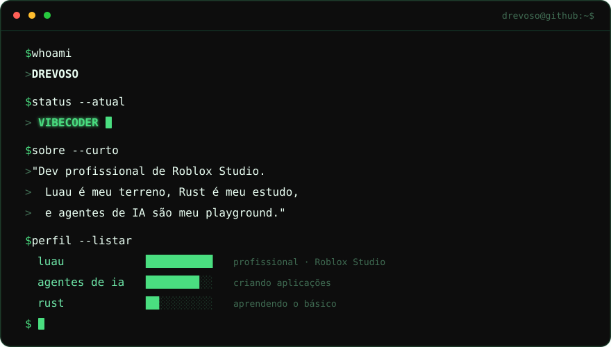

<div align="center">
  
</div>

## >_ projetos/

```bash
(vazio por enquanto)  # em breve: os primeiros repos chegam aqui
```

## >_ estatísticas/

<div align="center">
  
  
</div>

<div align="center">
  
</div>

<div align="center">
  
</div>

## >_ contato/

<div align="center">
  
</div>

<div align="center">
  <sub>feito com vibes e agentes de IA no loop</sub>
</div>
